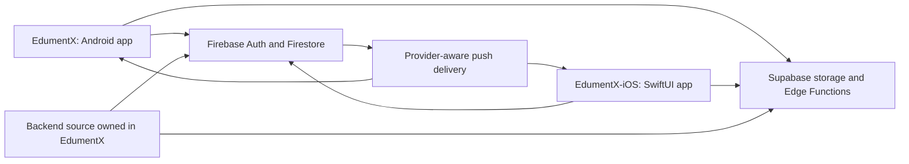

# EdumentX: Android and native Swift iOS split

**Status: approved on 21 October 2026.** The independent Swift repository has been created at `~/Projects/EdumentX-iOS`; The Gate A source/core milestone is implemented and verified on Linux. Apple SDK/device/integration gates remain pending, so the existing iOS target is preserved.

## 1. What you asked for

- Keep the current EdumentX repository as the Android application.
- Remove its active iOS application configuration and iOS-specific implementation.
- Create a separate repository for a complete native iOS EdumentX app, using Swift/SwiftUI and xtool from Ubuntu.
- Keep the actual student, tutor and admin features, with a path toward publication.

This is a second client implementation, not an APK conversion or a React Native file translation. Swift gives the iOS client its own native interface and lifecycle. Product changes, bug fixes and tests must then be maintained in two languages.

The reason for this design is your preference to develop iOS through xtool on Ubuntu. A Swift rewrite can fit xtool's SwiftPM project model, but does not automatically establish compatibility with every dependency or App Store distribution.

## 2. Findings that affect the decision

| Finding | Evidence and limit |
|---|---|
| Local tools are available | `xtool --version` reports 1.22.2; `swift --version` reports 6.4.1 on x86_64 Ubuntu. A Foundation program previously compiled and ran on Linux. |
| The Apple cross-compilation SDK is absent | `xtool sdk status` still reports `Not installed`. No iPhone build, signing or device test has been completed. |
| SwiftUI/SwiftPM is the intended xtool app model | The released `xtool new` scaffold and `xtool dev build --help` describe a SwiftPM app. The existing React Native app does not fit that build model. |
| Native Firebase dependency compatibility is unproven | Firebase supports SwiftPM, but that fact alone does not prove the complete package graph builds with Linux-hosted xtool. [Issue #310](https://github.com/xtool-org/xtool/issues/310) includes a user's report of framework/resource problems; this is evidence of risk, not proof every Firebase configuration is impossible. |
| App Store distribution remains unresolved for the selected tool release | [Distribution signing PR #326](https://github.com/xtool-org/xtool/pull/326) was open, draft and unmerged at review. Its proposed flags are not released 1.22.2 instructions. A development IPA is not evidence of TestFlight acceptance. |
| Asset packaging needs a separate check | Released xtool supports plain resources; [asset catalog PR #325](https://github.com/xtool-org/xtool/pull/325) was still draft/unmerged and discusses App Store processing problems. Plain PNG/SF Symbols can support development, but do not prove store icon/resource compliance. |
| Push delivery needs shared backend work | [The existing push sender](../../functions/src/index.ts) sends stored strings to Expo's API. An APNs or native FCM token cannot be substituted for an Expo token. |

The Apple SDK is still required for the native Swift path. xtool's [Linux setup](https://github.com/xtool-org/xtool/blob/1.22.2/Documentation/xtool.docc/Installation-Linux.md) extracts it from a licensed Xcode archive; the Xcode application does not run on Ubuntu. Apple signing and store membership remain separate account requirements.

**Decision boundary:** a fully Linux-only, released-xtool-to-App-Store pipeline cannot be promised from the current evidence. If that is a strict requirement, the project must retain an explicit distribution blocker until a supported path is demonstrated. Do not disguise an experimental branch or a remote Mac step as a verified Linux-only release.

For this proposal, **Linux/xtool is the selected requirement**, inferred from your repeated tool preference. If the distribution trial fails, record the release as blocked; do not switch to a Mac-assisted pipeline automatically. A later change to that requirement needs your decision.

## 3. Proposed approach

Build the Swift client in stages. Prove the toolchain and backend integration before removing the current iOS target. Preserve the existing Android app and its uncommitted work throughout.

The user approved this staging order. The final target remains the Android-only repository and separate full native iOS client requested; creating the new repository does not close the native feasibility or parity gates.



### Repository responsibilities

| Repository | Responsibilities |
|---|---|
| Existing `EdumentX` | Android React Native/NativeWind app; one authoritative copy of Firestore rules/indexes, Firebase Functions, Supabase migrations/Edge Functions, shared backend contracts and security tests. |
| New `EdumentX-iOS` | Native SwiftUI app, Swift domain models and adapters, iOS capabilities/resources, xtool build scripts, native tests and its own concise setup/learning guide. No duplicated backend deployment source. |

Approved local location: **`~/Projects/EdumentX-iOS`**, on the Linux filesystem. It is initialized as an independent local Git repository on `feat/xtool-foundation`. Do not nest it inside the Android repository or copy the Android `node_modules`, `.git`, `.env`, signing files, service accounts or private documents. GitHub publication is a separate step; no remote is configured for the new repository.

Use the same approved Firebase and Supabase environments for both clients. Register/retain the appropriate iOS application identity; do not create a second database or migrate users merely because the client language changed. Android and iOS application registrations are distinct even when they share an environment.

## 4. Swift application structure

These are proposed implementation choices, open to review:

- Swift 6.4.1 and xtool 1.22.2 as the initial tested host versions; pin/update deliberately.
- SwiftUI for screens, navigation, forms and accessibility; UIKit bridges only where a platform API needs them.
- An initial minimum of iOS 17, to be checked against intended devices before registering the release configuration.
- Foundation-based domain code in an independent Swift package that can be tested on Linux.
- MapKit/CoreLocation for native maps/location; UserNotifications for notification permission/deep links; Keychain for session credentials. Each still needs an Apple-SDK build and device check.
- No React Native, Expo runtime, CocoaPods, Clerk or JavaScript engine in the Swift client.

Proposed structure:

```text
EdumentX-iOS/
  Package.swift                 # xtool's iOS app library product
  Package.resolved              # when external packages are approved/pinned
  xtool.yml
  Sources/EdumentXApp/
    App/                        # entry point, session routing, dependencies
    DesignSystem/               # named colors, spacing, typography, controls
    Features/
      Auth/ Student/ Tutor/ Admin/ Messaging/ Support/
    Platform/                   # Keychain, maps, uploads, notification bridges
    Resources/                  # reviewed icons, strings and usage descriptions
  Packages/EdumentXCore/
    Package.swift
    Sources/EdumentXCore/        # models, validation, pure calculations, protocols
    Tests/EdumentXCoreTests/
  Tests/                        # device/integration scenarios and fixtures
  scripts/                      # toolchain/config checks and reproducible builds
  Documentation/                # setup, architecture, parity and release evidence
  README.md
  AGENTS.md                     # Swift-specific rules for this repository
  .gitignore
```

The core package stays independent of SwiftUI and Apple-only SDKs. `swift test --package-path Packages/EdumentXCore` validates that core; it must never be presented as compiling or testing the iOS interface. The app target must actually build through xtool after the Apple SDK is supplied.

Keep business operations behind protocols such as Auth, TutorDiscovery, Enrollments, Batches, Messages, Reviews, Verification and Notifications. SwiftUI feature state runs on the main actor. Network/token coordination must prevent parallel refresh races and cancel user-specific work on logout. Package boundaries and exact type names remain the implementer's choice.

## 5. Choose data adapters from evidence

### Preferred: native SDKs, after a compatibility trial

Try the smallest required official Firebase products and authentication integration with the installed xtool toolchain. Use pinned package versions and record transitive binaries, build scripts and resource requirements. Firebase's [Apple setup](https://firebase.google.com/docs/ios/setup) and [installation methods](https://firebase.google.com/docs/ios/installation-methods) establish the supported SDK installation model, not a guarantee for this Linux toolchain.

The trial must prove: dependency resolution, iOS compilation/linking, app launch, user-token authentication, authorized Firestore query/write, token refresh after relaunch, and listener teardown/reconnection. Add the Google/Apple authentication paths before calling the authentication layer complete.

Do not add packages to the main app or claim SDK integration works because `Package.swift` parses. Do not load Analytics or other unrelated SDK products by default.

### REST is a fallback design, not an automatic substitute

Foundation `URLSession` can call Firebase Auth, Firestore REST and existing Edge Functions. A production adapter would still need typed Firestore values, explicit update masks/deletions, server timestamps/increments, transactional read/commit/retry behavior, query cursors, user-token refresh and secure persistence.

A few GET/PATCH requests cannot replace the current SDK's listeners, offline behavior and multi-document transactions. Do not use private Firestore transport protocols or silently replace chat with aggressive polling. If native SDKs fail, return a concrete adapter/backend design for review before continuing; do not quietly remove realtime behavior or weaken rules to unblock it.

Never ship Firebase Admin credentials, Supabase service-role keys, Groq keys or Apple signing material in either client. Client requests use the authenticated user's Firebase ID token and remain subject to authorization.

## 6. Full feature parity target

"Full" means the actual student, tutor and admin journeys below, plus shared release-readiness fixes. A set of mock screens is an early prototype, not completion.

| Area | Required native behavior | Existing source to port as behavior |
|---|---|---|
| Session/auth | Email signup/login, verification/resend/reload, returning-user role restoration, Google login, cancellation/errors, logout; add password recovery and resolve Apple login requirements. | `src/services/firebase/authService.ts`, `src/app/_layout.tsx`, `src/screens/auth/EmailSignUp.tsx` |
| Onboarding | Student profile; tutor profile, documents and pending-review lifecycle; resume partial setup without assigning the wrong role. | `src/screens/auth/*`, `src/screens/tutor/PendingReview.tsx` |
| Student discovery | Search/filter/sort, list/map, tutor details, review summaries/list, saved tutors, sharing and availability-aware enrollment entry. | `src/lib/tutor/*`, `src/screens/student/*`, `src/services/tutors/*`, `src/services/savedTutors/*` |
| Enrollment | Request/edit/withdraw; active/pending/past lists; tutor accept with a concrete slot; decline, remove, expiry, capacity and student-location authority. | `src/services/enrollments/*` |
| Tutor dashboard | Live roster/capacity, pending requests, today's derived sessions, ratings, profile completeness and search-visibility toggle. | `src/screens/tutor/TutorHome.tsx`, enrollment/review repositories |
| Availability/batches | Weekly grid, save/cancel, booked slots, batch wizard, roster picker, add/remove, session-code joining, ended-batch history. | `src/services/batches/*`, `src/screens/tutor/BatchCreation.tsx`, enrollment repository |
| Messaging | Shared thread identity across clients, inbox, send/retry, unread state, read receipts, typing and safe pagination. | `src/services/messages/*` |
| Notifications | Inbox/read state, provider-correct push, permissions, token ownership, rotation and authenticated deep links after cold start. | `src/services/notifications/pushService.ts`, `functions/src/index.ts` |
| Verification/profile | Avatar and document/video uploads, short-lived private previews, edit proposals, rejection/more-info handling and profile editing. | `src/services/supabase/storage.ts`, tutor/admin screens, verification Edge Functions |
| Admin | Live KPIs, verification/edit queues, approvals, suspension and account lifecycle; custom-claim authority enforced server-side. | `src/screens/admin/*`, `src/lib/admin/*`, `firebase/firestore.rules` |
| AI finder | Existing authenticated chat/constraints/results, location permission behavior, honest unavailable states and consistent tutor visibility. | `src/services/ai/*`, `supabase/functions/chat/*`, `groq-proxy` |
| Support/safety | FAQ/contact, privacy/terms/deletion surfaces, self-deletion, report/block and appropriate error recovery. | Current support/profile screens plus missing work in `PRODUCTION_READINESS.md` |
| Subscription | Read server-owned tier correctly; preserve entitlement authority. Disable consumer sandbox purchase/grant entry points until a separate compliant production-billing design exists. | `src/services/subscription/*`, `create-esewa-order` |

Preserve valid workflows; do not port known security defects just to match behavior. Admin UI must never manufacture an admin claim. Existing operator hard-purge code is not a complete user-facing deletion implementation.

## 7. Backend invariants both clients must share

1. **Identity/routing:** wait for authentication and role/profile loading before redirecting. Password users require verified email. Roles student/tutor belong to completed profile transactions; admin authority is the verified Firebase token claim `admin:true`, not a client-selected string.
2. **Discovery:** preserve approval/update/availability filters. Hidden or slot-less tutors must stay hidden in map, list and AI results. Firestore and Supabase search synchronization must be verified independently.
3. **Time:** `slotKey` remains `<day>:<slot>`, e.g. `mon:5-7`. Derive sessions from the active roster/date window in `Asia/Kathmandu`. Do not invent a sessions collection. Match malformed-value and legacy-row behavior through fixtures.
4. **Enrollment:** accept exactly once, recheck capacity/request state, update roster/counters and location-access authority atomically; include batch member/seat changes when applicable. Withdrawal, removal and expiry must be race-safe/idempotent. Read transaction dependencies before writes rather than copying questionable source operation order.
5. **Availability:** preserve `hasAvailability` in the public directory. The current sequential profile/directory writes can diverge; any consistency improvement must satisfy rules and be tested on both clients.
6. **Batches:** direct tutor/batch/member paths; members keyed by enrollment ID; six-seat cap, duplicate-add handling and removal cascade. The free one-active-batch precheck is currently client-side and is not a proven security boundary.
7. **Reviews:** review changes and count/rating/category/star-distribution aggregates must remain consistent in transactions. Bound reads; do not duplicate the existing unbounded global review listener in the rewrite.
8. **Messaging:** preserve sorted UID pair joined by `__`; use fixtures to match JavaScript sorting semantics. Queries must match scalar `participantA`/`participantB` authorization. Pin participant identities and restrict metadata/unread/read-receipt writes before public release.
9. **Storage:** preserve Firebase JWT-authenticated server-owned upload paths. Use owner/admin signed URLs for private files; refresh after expiry and redact signed URLs. Respect current migration 017 rather than old anonymous-upload policy examples.
10. **Entitlements:** clients never grant Pro or change protected account status. Sandbox eSewa stays sandbox-only; its existence is not an App Store billing solution.

Create versioned JSON behavior fixtures and a compatibility ledger owned with the backend contracts. Both languages should consume the same expected slot/date/identity/serialization examples. Record the backend contract revision used by each client. Do not copy all backend deployment folders into the Swift repo.

## 8. Push architecture change

The current `users/{uid}.pushTokens` array contains Expo tokens. Preserve Android delivery while adding an explicit native iOS provider path. Proposed direction:

- A versioned, authenticated device-registration contract with owner, installation identifier, platform, provider, token and timestamps.
- Provider-aware server delivery: existing Expo for Android; native APNs directly or FCM-to-APNs for Swift, selected after the SDK/capability trial. Keep sender keys server-side.
- Staged compatibility for existing Android installations; no mass rewrite of their tokens.
- Token detachment/reassignment on logout/account switching, invalid-token cleanup, delivery receipt handling and safe retries.
- Notification payloads carry stable destinations; defer navigation until session/root routing is ready and recheck access to the destination.

Schema paths and provider selection need a separate concrete implementation proposal after the trial. In-app Firestore polling does not deliver background push when iOS suspends the process. See [Expo's native-token distinction](https://docs.expo.dev/push-notifications/sending-notifications-custom/).

### Product decisions kept outside the technical trial

The initial client/toolchain work uses synthetic adult test identities and no public registration rollout. It does not invent a new age/guardian policy, legal retention period or moderation policy. Those remain shared product decisions, not Swift-specific defaults.

Before Gate C implements the missing account/safety features, define the permitted age audience and guardian involvement; which records deletion erases/anonymizes/retains and for how long; and how blocking affects existing enrollments/batches and who handles reports. Write that separate shared-backend specification before coding those policy-dependent features. Until then, the new client can reconstruct existing workflows in development but cannot claim a consumer-release-ready safety/deletion implementation. This deferral does not close the existing P0 blockers.

## 9. Native interface and premium quality

Keep EdumentX's green/amber identity and warm surfaces, using a central Swift theme derived from existing tokens. Preserve licensed project assets and attribution. Screen names and data should stay familiar across clients; navigation should use iOS conventions rather than imitate Android controls.

Use native navigation stacks, sheets, accessible forms and semantic destructive actions. Student navigation centers on discovery/enrollments/profile, with messaging and notifications easy to reach; tutor navigation centers on today, requests, schedule and profile. Admin surfaces are separate and claim-gated.

Every important screen needs loading, empty, no-results, permission-denied, unavailable, retry and partial-content states where applicable. Respect Dynamic Type, VoiceOver, Reduce Motion, safe areas, keyboard overlap, swipe-back, cancelled requests and app backgrounding. Add visual effects only when they preserve legibility and measured performance.

Use plain resources/SF Symbols for the first xtool development trial. Store-quality icons, privacy manifests, usage descriptions and resource compilation remain an explicit packaging gate. Do not label generated assets or an unsigned bundle as App Store ready.

## 10. Android-only cutover checklist

Apply these changes together after the agreed feasibility/integration gate. Preserve a backup of ignored native files and a reversible revision of tracked source. The existing worktree contains unrelated and earlier task changes; do not reset or overwrite them.

| File/scope | Planned change |
|---|---|
| `app.json` | Set active platforms to Android; remove `ios` block and iOS-only permission copy. Preserve Android identifiers/plugins and assets. Remove the web platform/config only as part of the requested Android-only application scope, without rewriting shared components. |
| `app.config.js` | Remove the iOS file override; retain Android Firebase selection and production mock protection. Reject an explicitly requested legacy iOS build rather than silently recreating an iOS target. |
| `eas.json` | Remove iOS build-image settings; keep Android preview APK, production AAB and production APK. Explicit Android platform in all build/submit commands. |
| `package.json` | Remove the `ios` and active web-development entry points for an Android-only app. Keep all Android/shared dependencies unless actual usage proves otherwise. |
| Root `GoogleService-Info.plist` | Retire the legacy copy after the Swift client has its own intended iOS registration/configuration. Do not delete provider registrations, revoke signing ownership or alter the Android JSON as incidental cleanup. |
| Ignored local `ios/` | Inventory and back up outside the repository before retiring it. It is not tracked, so Git cannot restore it. Do not touch the customized ignored `android/` tree or run `prebuild --clean` in the working checkout. |
| `src/components/map/TutorMap.tsx` | Remove the isolated AppleMaps/IosMap implementation and export AndroidMap with shared props/helpers intact. Keep `expo-maps`. |
| Other platform branches | Remove remaining app-owned iOS-only keyboard/UA branches in a focused pass while preserving Android behavior. Do not alter platform implementations inside installed packages or reference archives. |
| Release doctor/tests | Make Android identifier/native-file checks authoritative; remove the two-platform comparison. Test that resolved config stays Android-only and keeps production mocks off. |
| Active docs/README | Describe this app as Android; link the Swift repository's actual location/status. Clearly retire the old React Native iOS release commands. Preserve useful historical/reference material rather than deleting every mention of iOS. |
| Backend/CI | Retain one backend owner, domain/rules tests and Android checks. No deletion of Firebase/Supabase iOS application registrations through a source cleanup. |

An npm dependency supporting both platforms is not unwanted iOS code in the Android app. Firebase, Google Sign-In, maps, gesture handling, haptics and safe-area packages remain necessary. A repository cannot remove platform code maintained inside its third-party packages without forking them; that is outside this split.

## 11. Quota and service constraints

No paid AI provider, live merchant key, new database or duplicated backend deployment is part of this proposal. Before installing a new dependency or adding a provider path, record the actual decision, quota math and spend controls in architecture §0 as required by repository instructions.

Two clients share the same backend quotas. Count simultaneous devices/sessions rather than assuming iOS has a separate free allowance. For example, repeatedly querying 20 Firestore documents every 30 seconds for eight foreground hours can consume about 19,200 document reads for one client before other reads. That makes naive polling unsuitable for the intended $0 demo budget.

Prefer bounded pages, existing secure aggregate patterns, listener teardown and foreground-aware work. Measure reads, writes, storage, functions, egress and Maps/geocoding use on named journeys. Budget alerts do not impose a hard spend cap. Store membership fees remain separate from backend demo traffic.

## 12. Implementation order and acceptance gates

### Gate A — toolchain, dependencies and release feasibility

After design approval, create the independent repository and Linux-testable core. The Apple SDK/device-dependent work waits for your licensed SDK archive and account/device setup.

Prove the smallest SwiftUI app, navigation/form state, map/location, resource packaging, session persistence and the selected Firebase/auth products on a physical iPhone through xtool. Record build logs, pinned packages, capabilities and which operations contacted Apple or a backend.

Investigate the App Store path separately: distribution entitlements/signature, packaging/icons/privacy manifests, upload/processing and TestFlight availability. Do not use unreleased options as a production recipe. A strict xtool-only store requirement remains blocked if these cannot be demonstrated; the next action is a documented decision, not silently substituting another build service.

**Exit:** known working development toolchain plus a truthful distribution decision. A failing dependency cannot be hidden behind mocks. No legacy iOS retirement before this result is reviewed.

### Gate B — one real cross-client workflow

Implement authentication/verification/routing, discover a permitted tutor, send one Android-to-Swift and one Swift-to-Android message, and create/accept one enrollment using synthetic development users. Prove refresh/relaunch, authorization failures, storage ownership, provider-correct push and account-switch cleanup.

**Exit:** real shared-backend evidence and a selected adapter/push design. Source-only UI or a passing core package does not satisfy it. At this point the Android-only cutover can proceed if Gate A permits the selected direction; full native parity is still in progress.

### Gate C — complete the parity matrix

Implement all student, tutor and admin rows; complete batch/review/verification/AI flows and account/safety work. Keep a ledger per feature: implemented, mocked, blocked, device-verified. Disable unfinished features explicitly in development rather than presenting placeholder success states.

**Exit:** cross-client scenarios below pass; shared P0 defects in [production readiness](../05-Build-and-Deploy/PRODUCTION_READINESS.md) are closed with tests. Neither client bypasses security or subscription rules.

### Gate D — release candidates

Create signed Android and native iOS candidates using the verified distribution paths. Complete privacy/support/deletion pages, store disclosures, reviewer accounts, age/audience decisions, device checks and rollout evidence. Repeat tool/store requirement checks at that time; current documentation is not permanent proof of acceptance.

**Exit:** tested artifacts and actual store processing/review state are recorded separately. No claim of publication before it occurs.

## 13. Required verification

- Linux Swift core tests cover deterministic conversation identity, exact field/date serialization, Kathmandu boundaries, slot parsing, capacity/expiry derivation, validation, token refresh coordination and cancellation.
- Shared Firestore emulator tests cover denied third-party access, immutable participants, role/claim escalation, transaction races, last-seat joins, remove/expiry idempotency and location-access revocation. Never replace the emulator's demo project with production.
- Cross-client tests prove one request accepted once, consistent counters/roster/batch membership, review aggregates, ended-batch history and message/read/unread behavior in both directions.
- Real iPhone tests cover Google/Apple auth, Keychain restore/logout, camera/photos/files, signed URL expiry, map/location denial, notification permission, background/terminated push and cold-start destinations.
- Account A logout/account B login on one device must never leak A's notifications, cached messages or identity files to B.
- Test Dynamic Type, VoiceOver, Reduce Motion, keyboard, long names/Nepali text, low bandwidth, offline interruption and recovery on named supported devices.
- Android cutover checks include lint/typecheck, release config and existing domain/motion/design-token tests, Android bundle export, disposable native-generation inspection and a signed device smoke test.
- Record the limits of each result: Linux tests, iOS compile, development install, distribution signing, upload, TestFlight access and App Review are distinct milestones.

No live smoke tests, SDK download/license acceptance, provider registration, key creation, paid cloud job or store submission is part of this design review.

## 14. Approved scope

The user approved this staged split: **a separate native SwiftUI repository with full feature parity as its target, shared backend ownership, feasibility gates before retiring the current iOS target, and an explicit blocker for any unverified xtool-only App Store path.** The first implementation plan covers Gate A; later gates follow its evidence. Policy-dependent account/safety changes require the separate product specification above rather than guessed behavior.

The local path, initial iOS 17 baseline, core-package layout and gate order are proposed engineering choices. Your request determines Android/native Swift as the intended split; it does not establish that the unresolved toolchain/distribution pieces already work.
